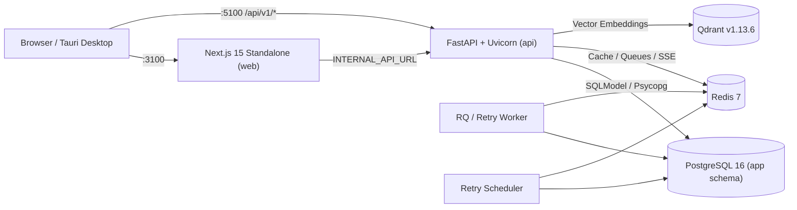

# 01. Full-Stack System Architecture

01. **High-Level Topology:**
    - Aurelinx is a containerized, multi-tenant, server-based HR intelligence monorepo split into `client/` (Next.js 15), `server/` (FastAPI), `infra/` (Docker Compose + Dockerfiles), and `desktop/` (Tauri wrapper).

02. **Container Port & Service Matrix (`infra/docker-compose.local.yml`):**
    - `web`: Node 20 Bookworm Slim, Next.js 15 standalone server on `3100 -> 3000`.
    - `api`: Python 3.12 Slim, runs `alembic upgrade head` then Uvicorn on `5100 -> 5000` (`IN_PROCESS_SCHEDULER=false`).
    - `worker`: Runs `PYTHONPATH=/app python scripts/retry_worker.py` for failed webhook/integration retries.
    - `scheduler`: Runs `PYTHONPATH=/app python scripts/retry_scheduler.py` for periodic retry scheduling.
    - `postgres`: `postgres:16-alpine` on `55432 -> 5432` with `app` schema initialization (`infra/postgres/init/`).
    - `redis`: `redis:7-alpine` on `56379 -> 6379` with AOF persistence and password auth.
    - `qdrant`: `qdrant/qdrant:v1.13.6` on `6333` (HTTP) and `6334` (gRPC).
    - `caddy` (optional `proxy` profile): Reverse proxy for local ports `80`/`443`.

03. **Backend Middleware Stack (`server/app/main.py`):**
    - Request ID tracing (`X-Request-ID`), Trusted Host validation (`ALLOWED_HOSTS`), CORS middleware, structured exception handlers, and `/health` exemption from HTTPS enforcement for Docker healthchecks.
