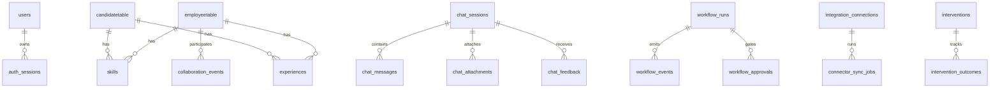

# 02. Database Schema and Migrations

01. **Relational Model (`server/app/models/database.py`):**
    - PostgreSQL 16 houses 48 SQLModel tables inside the `app` schema (`search_path=app,public`).
    - Every tenant-owned table enforces a `tenant_id: str` indexed column (`default="default"`).

02. **Domain Table Groups:**
    - **Identity & Auth:** `users`, `auth_sessions`, `email_verifications`, `registration_codes`, `oauth_states`.
    - **Workforce Core:** `employeetable`, `candidatetable`, `skills`, `skill_aliases`, `experiences`, `collaboration_events`, `vector_embeddings`.
    - **Chat & Agent Runtime:** `chat_sessions`, `chat_messages`, `chat_feedback`, `chat_attachments`, `workflow_runs`, `workflow_events`, `workflow_approvals`, `external_action_requests`, `external_action_attempts`.
    - **Data Ops & Medallion:** `data_contracts`, `raw_events`, `integration_evidence`, `quarantine_events`, `canonical_employees`, `canonical_candidates`, `gold_metric_snapshots`, `integration_connections`, `connector_field_mappings`, `connector_sync_jobs`.
    - **Integrations & Webhooks:** `integration_api_keys`, `integration_logs`, `integration_webhook_events`.
    - **Governance, MLOps & Privacy:** `ml_model_registry`, `ml_drift_snapshots`, `ml_model_cards`, `release_gates`, `dr_runbooks`, `procurement_artifacts`, `compliance_policies`, `privacy_consents`, `retention_policies`, `sensitive_field_policies`, `privacy_export_requests`, `forecast_scenarios`, `interventions`, `intervention_outcomes`, `audit_logs`.

03. **Alembic Migration Chain (`server/alembic/versions/`):**
    - `001_initial_schema.py` through `018_employee_employment_status.py`.
    - Migration `011_add_chat_audit_tenant_scope.py` safely inspects the schema and creates missing chat tables on a clean database before adding `tenant_id` columns and indexes.
