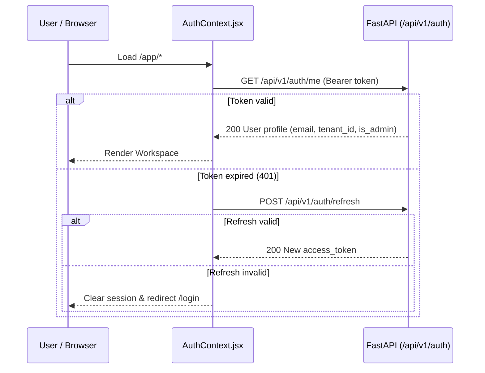

# 01. Next.js App Router and AuthContext

01. **Frontend Routing Architecture (`client/app/`):**
    - `client/app/page.jsx`: Public landing page (`LandingPage.jsx`) outside the authenticated workspace shell.
    - `client/app/login/page.jsx` & `client/app/signup/page.jsx`: Authentication screens (`AuthScreen.jsx`).
    - `client/app/app/page.jsx` & `client/app/app/[tab]/page.jsx`: Authenticated workspace (`App.jsx`) supporting deep routes `/app`, `/app/directory`, `/app/talent-scout`, `/app/sentiment-pulse`, `/app/enterprise-ops`, and `/app/intelligence-chat`.

02. **Authentication & Refresh Session Flow (`client/src/contexts/AuthContext.jsx`):**
    - Stores the bearer token for API calls and synchronizes session state with `/api/v1/auth/me` and `/api/v1/auth/refresh`.
    - Ensures stale refresh credentials are cleared on logout or revocation (`v0.2.9`).

03. **Bundle & Runtime Design (`infra/frontend.Dockerfile`):**
    - Multi-stage Node 20 build (`pnpm install --frozen-lockfile`, `next build` standalone output).
    - Startup script copies hashed static chunks into a persistent volume (`/app/.next/static`) and retains old chunks for 30 days so open browser tabs do not hit missing-chunk errors across deployments.
