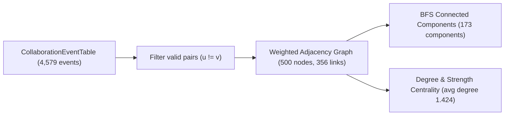

# 05. Organizational Network Analysis (ONA)

01. **Endpoint & Service (`GET /api/v1/intelligence/ona`, `server/app/services/ona.py`):**
    - Builds an undirected, weighted collaboration graph $G = (V, E, w)$ from `CollaborationEventTable` (`4,579` dated events in the demo bundle), excluding self-loops (`source == target`) and missing employee references.

02. **Graph Metrics Computed:**
    - **Edge Weight:** $w(u, v) = \sum \text{record\_count}(u, v)$ aggregated across event types.
    - **Average Degree:**
    $$\bar{k} = \frac{2 |E|}{|V|}$$
    - **Connected Components & Largest Component:** Computed via Breadth-First Search (BFS) over the adjacency list (`173` components, largest component size `15`, `40` isolated nodes in the `500`-node demo view).
    - **Per-Node Metrics:** Degree, weighted strength $\sum_{v \in N(u)} w(u, v)$, and cross-department bridge edges.

