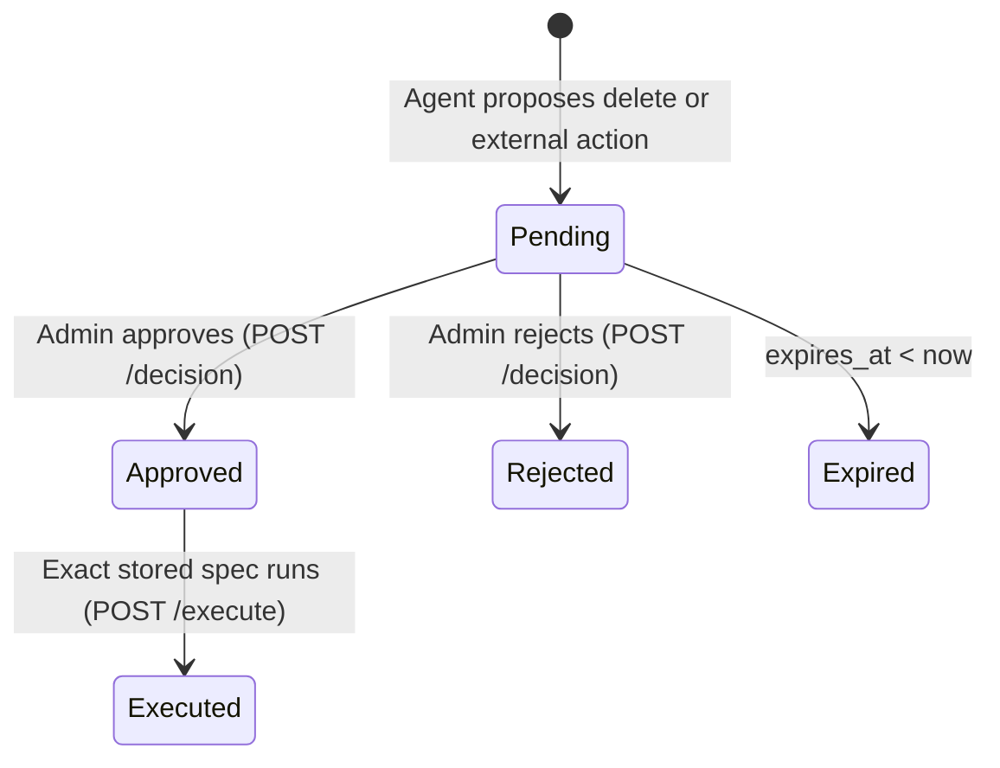

# 02. Seven-Tool Agent Workflow and Approval Gate

01. **Dynamic 7-Tool Runtime (`server/app/api/v1/chat.py`, `server/app/workflows/`):**
    - `search`: Tenant-scoped record lookup (never substitutes unrelated records on a no-match query).
    - `read`: Single-record inspection with automatic secret/file-path redaction.
    - `modify`: Admin-only (`is_admin=True`) updates blocking `id` and secret columns.
    - `write`: Admin-only record creation with duplicate protection.
    - `delete`: Never executes immediately; creates a `WorkflowApprovalTable` spec requiring explicit admin approval.
    - `analyse`: Aggregates workforce counts and department metrics.
    - `observe`: Returns structured patterns, symptoms, and delta observations.

02. **Actions & Approval Queue (`server/app/api/v1/actions.py`, `AgentActionsView.jsx`, `ApprovalModal.jsx`):**
    - `GET /api/v1/actions/capabilities`, `POST /api/v1/actions/proposals`, `GET /api/v1/actions/approvals/pending`, `POST /api/v1/actions/proposals/{action_id}/decision`, and `POST /api/v1/actions/proposals/{action_id}/execute`.
    - Every workflow execution emits observable `workflow_events` tied to `workflow_runs`.
