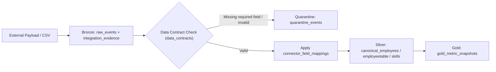

# 03. Schema Contracts, Mappings, and Quarantine

01. **Medallion Pipeline Architecture (`server/app/api/v1/lean_enterprise.py`):**

02. **Data Contracts (`GET/POST /api/v1/lean/contracts`):**
    - Stores `source_type`, `provider`, `version`, `required_fields` (JSON array), and `status` in `DataContractTable`.

03. **Field Mappings & Sync Health (`GET /api/v1/enterprise/sync-health`, `GET /api/v1/lean/quarantine`):**
    - Maps provider-specific field names into Aurelinx canonical fields via `ConnectorFieldMappingTable`.
    - Tracks `quarantined_total` and recent `ConnectorSyncJobTable` runs so operators can inspect pipeline health at a glance.
