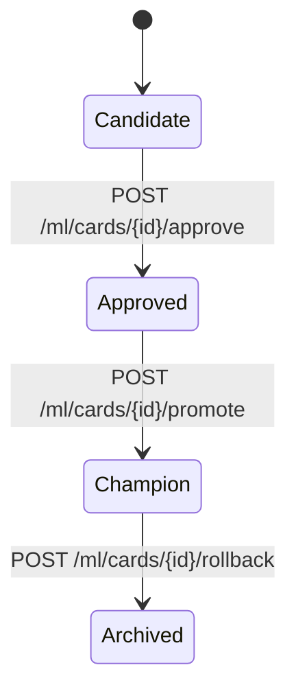

# 01. Model Registry and Model Cards

01. **Model Registry (`ml_model_registry`, `server/app/api/v1/lean_enterprise.py`):**
    - `POST /api/v1/lean/ml/train`: Trains and registers a versioned tenant model artifact.
    - `GET /api/v1/lean/ml/models`: Lists registered models and versions.
    - `POST /api/v1/lean/ml/score`: Scores records using an active registered model.

02. **Model Cards & Promotion Lifecycle (`ml_model_cards`):**
    - `GET /api/v1/lean/ml/cards`: Lists model cards with evaluation metrics (`pr_auc`, `calibration_error`, `fairness_gap`).
    - Lifecycle transitions: `POST /api/v1/lean/ml/cards/{card_id}/approve` -> `/promote` (`champion`) -> `/rollback` (`archived`).

